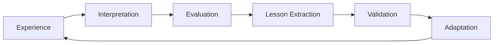
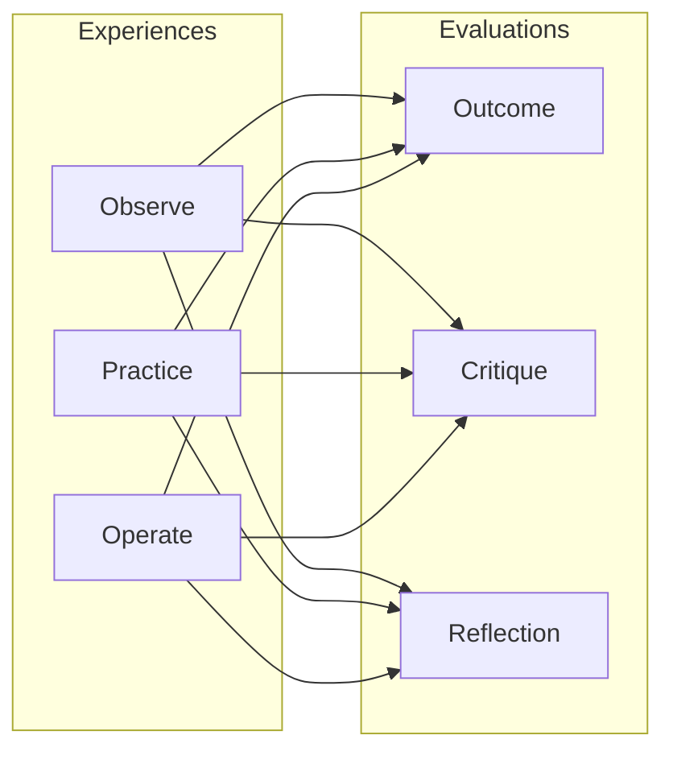

SAIP exists to close a loop that most AI deployments leave open: the gap between using a model and improving it. This page explains the conceptual framework behind that loop — not the commands to run, but why the system is structured the way it is.

## The Fundamental Loop

Continual learning reduces to three phases that repeat indefinitely:

```
Experience → Evaluation → Adaptation → (repeat)
```

Each phase is necessary. Experience without evaluation is just data hoarding. Evaluation without adaptation is just auditing. Adaptation without experience is just drift. The loop only produces improvement when all three phases are present and connected.

In practice, each of these three phases decomposes into finer-grained stages. The full loop includes interpretation (making sense of raw experience), lesson extraction (distilling generalizable principles from evaluation), and validation (confirming that adaptations actually improve behavior):



This expanded view makes explicit what the simple three-phase loop leaves implicit: experience must be *interpreted* before it can be evaluated (raw session logs are not self-explanatory), evaluation must be *distilled* into lessons before it can drive adaptation (individual feedback scores are not training data), and adaptations must be *validated* before they re-enter the experience phase (unvalidated updates are just drift).

SAIP maps these phases to concrete system components:

| Phase | SAIP Component | What It Captures |
|-------|---------------|------------------|
| Experience | Sessions | Conversations, tool use, artifacts |
| Interpretation | Dataset Builder | Filtering, formatting, provenance tagging |
| Evaluation | Feedback | Rewards, critiques, corrections |
| Lesson Extraction | Training Pipeline | SFT/KTO/GRPO dataset construction |
| Validation | Promotion Workflow | Held-out evaluation, metric comparison |
| Adaptation | Training | Adapter updates via SFT/KTO/CPT/GRPO |

The mapping is not one-to-one. Understanding *why* requires unpacking what each phase actually means.

## Three Types of Experience

Not all experience is equal. The epistemic quality of experience determines what can be learned from it.

### Observed / Instructed Experience

This is experience received passively: documentation read, tutorials followed, demonstrations watched. In SAIP terms, this is the **knowledge corpus** — documents, repositories, and datasets uploaded to R2's `knowledge/` prefix.

Observed experience teaches *what is true* but not *what works*. A model that has read ten thousand Stack Overflow answers knows many solutions but has never debugged a failing test at 2 AM. It has knowledge without judgment.

### Performed Experience

This is experience generated by the agent itself during interaction. In SAIP, this is **session data**: the actual conversations between callers and the inference gateway, including tool calls, code generation, and multi-turn reasoning.

Performed experience is richer than observed experience because it includes *decisions under uncertainty*. The model chose this response over that one. It committed to a particular interpretation. Those choices are learnable signal, even when they're wrong — especially when they're wrong.

### Situated / Real-World Experience

This is performed experience that carries external consequences. A code suggestion that was deployed and broke production. A research summary that informed a business decision. A diagnosis that affected patient care.

Situated experience is the most valuable kind because it includes **ground truth feedback**. The world responded. SAIP captures this through feedback records that link outcomes back to specific session messages. Without situated experience, the learning loop optimizes for plausibility rather than effectiveness.

## Three Types of Evaluation

Evaluation transforms raw experience into learnable signal. Without evaluation, experience is just tokens.

### Outcome Evaluation: Did It Work?

The simplest form: a binary or scalar judgment of success. The code compiled. The answer was correct. The task completed. In SAIP, this is the `reward` field in feedback records: a number from -3 to +3 indicating outcome quality.

Outcome evaluation tells you *what* to reinforce but not *why*. A reward of +3 says "do more of this" without distinguishing whether the response was good because of its structure, its content, its tone, or luck.

### Critique Evaluation: Why?

Diagnostic feedback that identifies specific strengths and weaknesses. "The explanation was clear but the code example used a deprecated API." "The reasoning was sound but missed the edge case in the error handling."

Critique evaluation enables **corrective learning**. SAIP's corrective SFT method uses per-turn feedback to weight training examples: turns with negative feedback are masked (labels set to -100) or replaced with corrected responses, while positive turns are reinforced. The model learns not just what to do but what to stop doing.

### Reflection Evaluation: What Lesson?

Meta-evaluation that extracts generalizable principles from specific episodes. "When the user asks about legacy APIs, always check the deprecation timeline before suggesting solutions." "For debugging tasks, reproduce first, explain second, fix third."

Reflection produces **strategy knowledge** rather than factual knowledge. It is the difference between memorizing that `Array.prototype.at()` exists and learning to prefer it over bracket indexing when bounds checking matters. SAIP's weighted KTO method captures this through scalar reward magnitudes: consistent small rewards for a behavioral pattern shape policy more reliably than occasional large rewards for specific outputs.

### The 3×3 Learning Matrix

Crossing the three experience types with the three evaluation types produces a 3×3 matrix of learning opportunities. Not every cell is equally populated in practice — situated experience rarely lacks outcome evaluation, and observed experience rarely receives reflection — but the matrix reveals gaps where learning signal could be cultivated:



The strongest learning signal comes from **operated experience evaluated by reflection**: real-world consequences analyzed for generalizable lessons. The weakest comes from **observed experience evaluated only by outcome**: knowing that a document exists without understanding why it matters. SAIP's dataset builder prioritizes cells with strong signal and flags underrepresented cells as opportunities for targeted data collection.

## Raw Experience ≠ Training Data

This distinction is critical and often overlooked. A session log is not a training dataset. The transformation between them is where learning actually happens.

Raw experience is **episodic**: timestamped, contextual, noisy, redundant. A twenty-turn conversation might contain three useful exchanges buried in clarification questions, tangents, and formatting artifacts. Training on the raw transcript would teach the model to ask unnecessary clarifying questions and produce verbose preambles.

Training data is **curated**: filtered, weighted, formatted, deduplicated. The dataset builder in SAIP's training gateway performs this transformation:

1. **Selection**: which sessions contain learnable signal? (filter by feedback presence, outcome quality, domain relevance)
2. **Weighting**: how much should each turn contribute? (per-turn feedback scores become sample weights)
3. **Formatting**: what structure does the training method expect? (completion format for CPT, instruction-response pairs for SFT, scalar-labeled examples for KTO)
4. **Provenance tagging**: where did this example come from? (observed vs performed vs situated — affects trust and generalization expectations)

Skipping this transformation — feeding raw sessions directly into training — produces models that replicate the average behavior in the session log rather than the best behavior. The transformation step is where evaluation becomes actionable.

## Knowledge, Strategy, and Preference Learning

:::caution[Architectural Invariant]
**Knowledge ≠ Strategy ≠ Preference.** These are three fundamentally distinct learning dimensions. They use different training methods, different signal types, and different evaluation criteria. Conflating them — treating knowledge gaps as preference problems, or encoding preferences as knowledge — produces models that are knowledgeable but incompetent, competent but misaligned, or aligned but ignorant. Every dataset construction decision and every training run should be explicit about which dimension it targets.
:::

The training methods in SAIP correspond to these three distinct things a model can learn:

### Knowledge Learning (What Is True)

**Method**: Knowledge Embedding (Continued Pretraining)
**Signal**: Raw text from documents, codebases, literature
**Learns**: Domain vocabulary, factual relationships, world model refinements
**Analogy**: Reading textbooks before taking a class

Knowledge learning changes what the model *knows*. It does not change how the model *behaves*. A model trained on medical literature knows more medicine but is not necessarily a better diagnostician. Knowledge is necessary but insufficient.

### Strategy Learning (How To Act)

**Method**: Corrective SFT (Feedback-Weighted)
**Signal**: Session turns weighted by critique and outcome feedback
**Learns**: Task decomposition patterns, error avoidance, correction internalization
**Analogy**: Practicing problems with a tutor who marks mistakes

Strategy learning changes how the model *approaches tasks*. It encodes procedural knowledge: when to ask for clarification, when to show work, when to defer. Strategy is learned from performed experience evaluated by critique.

### Preference Learning (What To Value)

**Method**: Weighted KTO (Scalar Reward)
**Signal**: Scalar rewards with confidence weighting across many interactions
**Learns**: Behavioral tendencies, tone calibration, risk tolerance, verbosity preferences
**Analogy**: Developing taste through repeated exposure and feedback

Preference learning changes what the model *optimizes for*. Unlike strategy learning, which teaches specific procedures, preference learning shapes the model's implicit objective function. A model that consistently receives small positive rewards for concise answers will gradually prefer conciseness, even in contexts where no explicit feedback was given.

These three types of learning are **complementary, not interchangeable**. A model with knowledge but no strategy is a knowledgeable fool. A model with strategy but no preferences is a competent but tone-deaf executor. A model with preferences but no knowledge is confidently wrong.

## Epistemic Provenance

Where experience comes from matters for how much to trust it. SAIP tracks three provenance categories:

- **Observed**: sourced from uploaded documents, repositories, or datasets. High reliability for factual knowledge, low reliability for behavioral norms (documents describe what people say they do, not what they actually do).
- **Simulated**: generated by the model itself during self-play or synthetic data generation. Useful for exploring edge cases but carries the risk of mode collapse (the model reinforces its own biases).
- **Speculative**: hypothetical scenarios or counterfactual reasoning. Valuable for stress-testing strategies but should be downweighted in training relative to situated experience.

Provenance informs the weighting step in dataset construction. Situated performed experience (a real user gave real feedback on a real task) gets the highest weight. Observed knowledge gets moderate weight for CPT but low weight for behavioral training. Speculative examples get minimal weight unless validated by subsequent situated experience.

## Generalization: From Episodes to Rules

The ultimate goal of the learning loop is not to memorize specific sessions but to extract **reusable principles** from them. This is the hardest part of continual learning and the part most likely to fail silently.

A model that memorizes "when user X asks about Y, respond with Z" has not learned. It has cached. Generalization requires abstraction: recognizing that user X's question about Y is an instance of a broader category, and that response Z works because of a principle that applies to that category.

SAIP encourages generalization through several mechanisms:

- **Aggregation across sessions**: KTO training sees rewards from many callers and many contexts. Patterns that hold across diverse situations survive; idiosyncratic preferences wash out.
- **Feedback dimensions**: multi-dimensional feedback (not just a scalar) allows the model to learn that "concise" and "accurate" are separate axes that sometimes conflict.
- **Adapter composition**: specialized adapters capture domain-specific knowledge while the base model retains general capabilities. Generalization happens at the composition level, not just within a single model's weights.
- **Versioned promotion**: adapters are versioned and evaluated before promotion. An adapter that improves performance on held-out evaluations has generalized; one that only improves on training data has memorized.

The learning loop does not guarantee generalization. No system does. But by making the transformation from experience to training data explicit, by separating knowledge from strategy from preference, and by tracking epistemic provenance, SAIP makes generalization failures visible and addressable rather than invisible and permanent.

## Why This Structure?

You might ask: why not just fine-tune on all session data with uniform weighting? Why the elaborate taxonomy of experience types, evaluation modes, and learning categories?

Because **uniform treatment of heterogeneous signal produces homogeneous mediocrity**. A session where the model hallucinated and received -3 feedback contains fundamentally different information than a knowledge document about API specifications. Treating them as equivalent training examples teaches the model that hallucinations are merely another style of response, weighted equally with factual documentation.

The learning loop's structure exists to preserve signal distinctions through the training pipeline. Each phase, each type, each weighting decision is a place where the system can respect the difference between knowing, doing, and valuing. That respect is what separates continual learning from continual noise accumulation.
