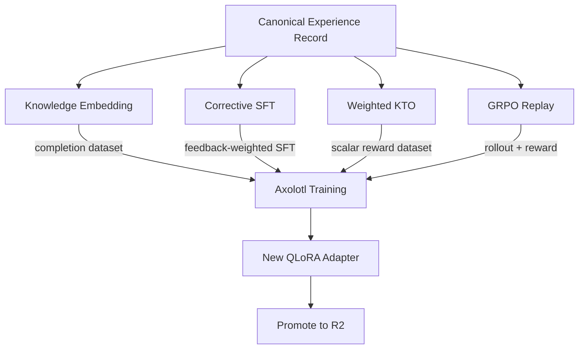

SAIP uses four distinct training methods, each teaching the model something different. They are not interchangeable alternatives — they are complementary tools that address different aspects of the learning loop. This page explains what each method teaches, how it works mechanically, and when to reach for it.

## Knowledge Embedding (Continued Pretraining)

### What It Teaches

Knowledge embedding teaches the model **domain familiarity**: vocabulary, factual relationships, structural patterns, and world-model refinements specific to a domain. It does not teach behavior, tone, or task strategy. It teaches *what exists* in a domain so that downstream behavioral training has something to work with.

Think of it as reading textbooks before attending lab. The model will not learn how to conduct experiments from textbooks alone, but without textbook knowledge, lab instruction is incomprehensible.

### Input Format

Knowledge embedding uses **raw text completion datasets**. The model sees contiguous text and learns to predict the next token:

```
The Kubernetes API server exposes a RESTful interface on port 6443.
Authentication is handled through X.509 client certificates, bearer tokens,
or authenticating proxy headers. Authorization decisions are made by the
RBAC authorizer, which evaluates Role and ClusterRole bindings against...
```

There are no instructions, no questions, no response boundaries. The model simply continues the text. This format preserves the natural distributional statistics of the source material: sentence structure, paragraph organization, terminology density, and conceptual co-occurrence patterns.

### When to Use

- **New domains**: your agent needs to understand a codebase, scientific literature, legal corpus, or internal documentation that the base model was not pretrained on.
- **Vocabulary gaps**: the base model knows Python but not your internal DSL; knows general medicine but not your hospital's protocol abbreviations.
- **World model refinement**: the base model's understanding of a domain is outdated or superficial, and you need deeper structural knowledge.

### Limitations

LoRA adapters have finite capacity. A rank-16 adapter has roughly 4 million trainable parameters for a 4B model — enough to encode behavioral adjustments and moderate domain knowledge, but not enough to memorize a 500-page technical manual verbatim. Knowledge embedding through LoRA works best for:

- Terminology and concept relationships (high compression)
- Structural patterns and conventions (moderate compression)
- Specific facts and procedures (low compression — may require higher rank or full fine-tuning)

If your knowledge corpus exceeds what a LoRA adapter can absorb, consider retrieval-augmented generation (RAG) as a complement: let the adapter encode the *structure* of the domain while retrieval provides specific facts on demand.

## Corrective SFT (Feedback-Weighted)

### What It Teaches

Corrective SFT teaches the model **how to correct mistakes and avoid repeating them**. Unlike standard supervised fine-tuning, which treats all training examples equally, corrective SFT uses per-turn feedback to weight the training signal: good responses are reinforced, bad responses are suppressed or replaced.

This is the primary mechanism for turning session feedback into behavioral improvement. When a user marks a response as unhelpful and provides a correction, corrective SFT ensures the model learns from that correction rather than averaging it with the original mistake.

### Per-Turn Feedback Weighting

Standard SFT computes loss uniformly across all tokens in a response. Corrective SFT modifies this by incorporating per-turn feedback scores:

```
Turn 1 (feedback: +2): normal loss computation
Turn 2 (feedback: -1): labels masked to -100 OR replaced with correction
Turn 3 (feedback: +3): normal loss computation, optionally upweighted
Turn 4 (feedback: 0): neutral — included but not emphasized
```

The feedback score determines the treatment:

- **Positive feedback (+1 to +3)**: the response is treated as a gold-standard example. Loss is computed normally, and the example may be upweighted in the batch sampling distribution.
- **Negative feedback (-1 to -3)**: two strategies are available:
  - **Masking**: set all label tokens to -100, which causes PyTorch's cross-entropy loss to ignore them. The model sees the context but does not learn to reproduce the bad response.
  - **Replacement**: substitute the corrected response (from user feedback or human review) as the target. The model learns the right answer in the same context where it previously gave the wrong one.
- **Neutral feedback (0)**: the example is included for context continuity but receives no special weighting.

### Internalized Correction vs Correction-Context Training

There is a subtle but important distinction between two ways to handle corrections:

**Internalized correction** replaces the bad response with the good one and trains on the corrected version as if it were the original output. The model learns to produce the correct response directly. This is preferred when the correction represents a stable, generalizable improvement.

**Correction-context training** keeps both the bad response and the correction in the training data, formatted as a multi-turn exchange: "Here is my initial answer... Actually, that was wrong because... Here is the correct approach..." The model learns to self-correct. This is preferred when the mistake reveals a reasoning pattern worth preserving (e.g., common misconceptions that should be addressed proactively).

SAIP supports both modes. The choice depends on the nature of the feedback: systematic errors benefit from internalized correction; context-dependent errors benefit from correction-context training.

### Span-Level Feedback Weighting

Per-turn feedback is coarse: a single score for an entire response. Sometimes the feedback targets a specific span within a response ("the explanation is good but the code example is wrong"). SAIP's feedback records support optional `message_id` targeting, enabling span-level weighting:

- The flagged span receives the feedback score directly.
- Unflagged spans within the same response retain neutral weight.
- This prevents good portions of a mixed-quality response from being suppressed along with the bad portion.

Span-level feedback is more expensive to collect (requires UI support for inline annotation) but produces significantly cleaner training signal for complex responses.

## Weighted KTO (Scalar Reward)

### What It Teaches

Weighted KTO teaches **behavioral policy shaping**: not specific responses to specific inputs, but general tendencies about what kinds of responses are preferable. It operates on scalar rewards rather than paired preferences, making it suitable for continual learning where pairwise comparisons are rarely available.

Where corrective SFT says "this specific response was bad, do this instead," weighted KTO says "responses with these characteristics tend to receive positive feedback across many contexts." The model internalizes a reward landscape rather than memorizing corrections.

### Scalar Reward Magnitudes

SAIP feedback records carry rewards in the range **-3 to +3**, with optional confidence weighting. These are not arbitrary scores — they map to qualitatively distinct signal levels:

| Score | Meaning | Training Signal |
|-------|---------|----------------|
| +3 | Exceptional, exemplary response | Strong positive reinforcement |
| +2 | Clearly good, meets expectations well | Moderate positive reinforcement |
| +1 | Acceptable, minor issues | Weak positive reinforcement |
| 0 | Neutral, no signal | Baseline reference |
| -1 | Below expectations, fixable issues | Weak negative signal |
| -2 | Significantly flawed, misleading | Moderate negative signal |
| -3 | Harmful, dangerous, completely wrong | Strong negative signal |

### The Magnitude Function

A naive approach would treat reward magnitude linearly: a +3 is three times as influential as a +1. This is wrong for two reasons:

1. **Reward calibration is nonlinear in practice**: the difference between +2 and +3 is often larger than the difference between +1 and +2, because extreme scores require stronger justification.
2. **Outlier dominance**: linear scaling lets rare extreme scores dominate the gradient, destabilizing training.

Weighted KTO uses a **configurable magnitude mapping** — this is a design choice, not a fixed algorithm. The recommended starting point is a discrete lookup table:

| Score | Magnitude |
|-------|-----------|
| ±1    | 0.5       |
| ±2    | 1.0       |
| ±3    | 1.5       |

This sublinear mapping ensures that small rewards still contribute meaningful signal (not drowned out by noise), large rewards have outsized but bounded influence (not destabilizing), and the function is symmetric around zero (positive and negative signals scale identically). Teams can adjust these values or replace the table with a continuous function (e.g., `sign(r) × min(|r|^α, M)` with α ≈ 0.7–0.8) depending on their feedback distribution characteristics.

The confidence field further modulates magnitude: a +3 with confidence 0.5 contributes less than a +3 with confidence 1.0. This accounts for uncertain or noisy feedback without discarding it entirely.

### Neutral Example Handling

Standard KTO requires binary desirable/undesirable labels and discards neutral examples. Weighted KTO retains neutral examples (reward = 0) as **baseline references**. They anchor the reward distribution and prevent the model from drifting toward universally positive or negative policies.

Neutral examples serve as the "control group" in the training signal: they represent the current policy's default behavior. Deviations from neutral (positive or negative) are measured relative to this baseline, making the learned reward landscape more stable across training runs.

:::note[Two Meanings of Zero]
A reward of 0 carries an important ambiguity that dataset builders must resolve explicitly:

- **"No opinion"** — the evaluator had no basis for judgment (e.g., the task was outside scope, or the feedback was skipped). These examples should typically be **excluded** from training, as they carry no learnable signal.
- **"Acceptable behavior"** — the response was neither good nor bad; it met baseline expectations without excelling. These examples should be **retained** as baseline anchors, providing the reference point against which positive and negative rewards are measured.

SAIP distinguishes these cases through optional metadata on feedback records. When the distinction is unavailable, the conservative default is to retain zero-reward examples as baselines rather than discard potentially useful anchoring signal.
:::

### Comparison to Related Methods

| Method | Signal Type | Requires Pairs? | Best For |
|--------|-----------|-----------------|----------|
| Standard KTO | Binary (good/bad) | No | Simple preference alignment |
| DPO | Paired preferences | Yes | Offline RLHF with comparison data |
| GRPO | Group-relative rewards | No (group-based) | Online RL with reward models |
| Weighted KTO | Scalar + confidence | No | Continual learning with heterogeneous feedback |

Weighted KTO's advantage for SAIP is that it works with the feedback that naturally accumulates during inference: scalar scores from users, optionally with confidence and dimension breakdowns. It does not require constructing preference pairs (expensive), maintaining a reward model (complex), or running online RL loops (unstable). It converts the existing feedback stream directly into policy gradients.

## GRPO Replay (Group Relative Policy Optimization)

### What It Teaches

GRPO teaches **policy improvement through exploration**: rather than learning only from what the model actually did (observed experience), GRPO generates multiple candidate responses to the same prompt, evaluates them against a reward function, and learns from the *relative advantages* within each group. The model discovers better strategies by comparing alternatives it generated itself.

Where corrective SFT says "here is the right answer" and weighted KTO says "responses like this tend to be good," GRPO says "out of eight attempts at this problem, these two were best — learn what made them better."

### Simulated Replay of Historical Situations

SAIP uses GRPO for **simulated replay**: taking historical situations from past sessions and running them through the current policy to generate fresh candidate responses. This is analogous to a chess player reviewing past games with their current understanding — the situations are real, but the responses are newly generated.

The replay process works as follows:

1. Select historical prompts from the session archive (filtered for relevance and diversity)
2. Generate G candidate responses per prompt using the current adapter (typically G = 4–8)
3. Score each candidate against one or more reward functions
4. Compute relative advantages within each group (normalize scores so the group mean is zero)
5. Update the policy to increase the probability of above-average responses and decrease below-average ones

This approach extracts new learning signal from old situations. A prompt that received mediocre feedback in production may yield excellent candidates when replayed through an improved policy — and the contrast between candidates teaches the model what distinguishes better from worse.

### Complementarity with Weighted KTO

GRPO and weighted KTO are **co-equal training pathways** that address fundamentally different learning modes:

- **Weighted KTO learns from observed experience**: it shapes policy based on actual feedback from real interactions. The signal is grounded but limited to what happened to occur.
- **GRPO explores alternatives**: it generates counterfactual responses and learns from their relative quality. The signal is broader but synthetic.

Together they form a complete learning picture: KTO grounds the model in what users actually valued, while GRPO explores the space of what the model *could* do. KTO prevents GRPO from drifting into plausible-but-unhelpful behaviors; GRPO prevents KTO from overfitting to the specific responses that happened to be produced.

### Multi-Objective Rewards (GDPO)

GRPO naturally extends to **multi-objective optimization** through composite reward functions. SAIP's GDPO (Generalized Direct Preference Optimization) support allows combining multiple reward dimensions:

- **Correctness**: does the response solve the stated problem accurately?
- **Efficiency**: is the response appropriately concise without sacrificing clarity?
- **Safety**: does the response avoid harmful, misleading, or inappropriate content?

Each dimension produces a scalar score; the composite reward is a weighted combination. This lets GRPO optimize for balanced behavior rather than maximizing a single metric at the expense of others. The weights themselves become tunable hyperparameters that encode organizational priorities.

### Compute Considerations

GRPO requires significantly more compute than the other training methods because it generates rollouts during training. Each training step involves G forward passes per prompt (to generate candidates) plus the standard backward pass. For G = 8, this means roughly 8× the inference cost of SFT or KTO training.

Practical mitigations include:

- Using a smaller model or quantized weights for rollout generation
- Caching prompts and reusing rollouts across multiple gradient steps
- Running GRPO less frequently than KTO (e.g., one GRPO round per three KTO rounds)
- Limiting replay to high-value historical situations rather than the full session archive

Despite the cost, GRPO's ability to explore beyond observed data makes it essential for agents that need to improve proactively rather than only reactively.

## Axolotl Plugin Architecture

All four training methods described above — Knowledge Embedding, Corrective SFT, Weighted KTO, and GRPO Replay — are implemented as **Axolotl BasePlugin extensions**. Each method is a custom trainer class that plugs into Axolotl's training framework through its plugin API.

This is architecturally significant. Weighted KTO, for example, is *not* native Axolotl functionality — it is a SAIP-specific plugin that extends Axolotl's training loop with scalar reward weighting, magnitude mapping, and neutral example handling. Similarly, the GRPO replay trainer is a custom plugin that integrates rollout generation and group-relative advantage computation into Axolotl's training orchestration.

This design mirrors Cordis's **"everything is a plugin" philosophy** on the training side. Rather than forking Axolotl or maintaining patches against upstream, SAIP treats every training method as a composable, replaceable extension. This means:

- New training methods can be added without modifying Axolotl core
- Existing methods can be swapped or upgraded independently
- The training configuration remains declarative (YAML-driven) even for custom methods
- Upstream Axolotl updates can be adopted without resolving merge conflicts in custom training code

The plugin boundary enforces clean separation between training infrastructure (Axolotl) and training methodology (SAIP plugins), making both easier to maintain and evolve.

## Training Path Fan-Out

A single canonical experience record can contribute to multiple training pathways simultaneously. The diagram below shows how one experience fans out into four distinct training inputs, all converging on a unified Axolotl training run:



Not every experience feeds all four paths. Knowledge embedding draws from uploaded documents and corpora; corrective SFT and weighted KTO draw from session feedback; GRPO replay draws from archived prompts. But the canonical record format ensures provenance is preserved regardless of which path(s) an experience enters, enabling ablation analysis and auditability.

## When to Use Each Method

The four methods are complementary. A healthy continual learning cycle uses all of them, but not simultaneously or with equal frequency:

### Knowledge Embedding First

When introducing a new domain, start with knowledge embedding. Build the foundation before adding behavioral layers. A model that doesn't understand the domain cannot learn domain-appropriate behavior, no matter how much feedback it receives.

**Frequency**: Infrequent. Run when onboarding new knowledge sources or when the base model's domain coverage is demonstrably insufficient.

### Corrective SFT for Targeted Fixes

When feedback reveals specific, recurring mistakes, use corrective SFT. This is the surgical tool: precise corrections for identified problems. It works best when you have clear before/after examples from real sessions.

**Frequency**: Regular. Run whenever sufficient corrective feedback has accumulated (typically after a few dozen annotated sessions with negative feedback).

### Weighted KTO for Policy Shaping

When you want to adjust the model's general tendencies — tone, verbosity, risk tolerance, formatting preferences — use weighted KTO. This is the broad-shaping tool: gradual policy adjustments based on aggregate reward patterns.

**Frequency**: Periodic. Run on accumulated feedback batches when reward distributions show consistent trends (e.g., users consistently rate verbose responses lower).

### GRPO Replay for Exploration

When the model has plateaued under KTO and corrective SFT, or when you want to proactively discover better strategies rather than waiting for user feedback to reveal them, use GRPO replay. This is the exploration tool: generating alternatives to historical situations and learning from relative quality differences.

**Frequency**: Occasional. More compute-intensive than other methods; run when sufficient high-value historical prompts have accumulated and the model's current policy is stable enough to serve as a meaningful baseline for comparison.

### Combined Workflow

A typical learning cycle looks like:

1. Deploy adapter v1 (awake mode)
2. Accumulate sessions and feedback over days/weeks
3. Switch to sleep mode
4. Build datasets: CPT from new knowledge uploads, corrective SFT from flagged sessions, KTO from reward distributions, GRPO replay candidates from archived prompts
5. Train adapter v2 using one or more methods (KTO and GRPO can run sequentially on the same adapter)
6. Evaluate adapter v2 on held-out sessions
7. Promote adapter v2 if metrics improve
8. Return to awake mode with adapter v2

The methods compose: an adapter trained with corrective SFT can be further refined with weighted KTO, then explored further with GRPO replay. A knowledge-embedded adapter can receive behavioral corrections without losing its domain knowledge. The adapter versioning system tracks which methods contributed to each version, enabling rollback and ablation analysis.
